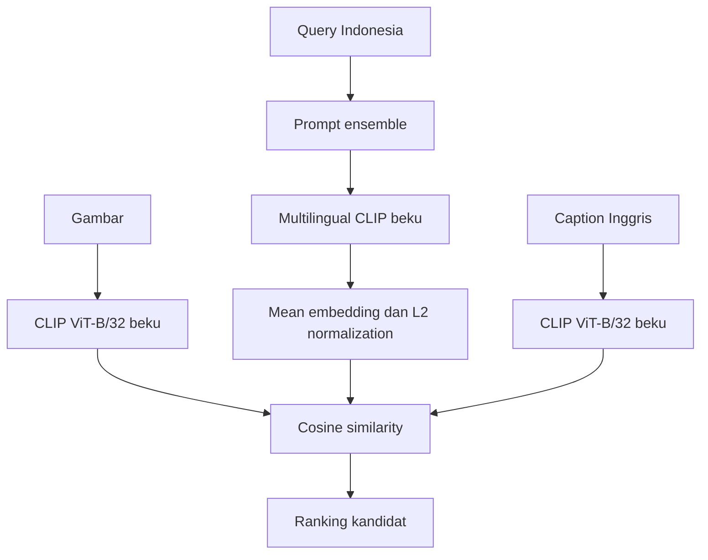

<div align="center">

# Indonesian Cultural Cross-Modal Retrieval

**Proyek Akhir Pembelajaran Mesin Multimodal — Kelompok 05**

Institut Teknologi Sumatera · IF25-40304 · Ganjil 2026/2027


[Pengenalan](#pengenalan) · [Milestone](#milestone) · [Hasil](#hasil-eksperimen) · [Cara menjalankan](#cara-menjalankan) · [Tim](#tim)

</div>

## Pengenalan

Proyek ini mengembangkan sistem pencarian lintas modal gambar dan teks untuk dokumentasi budaya Indonesia menggunakan SEA-VL Indonesian subset. Fokus penelitian adalah mengevaluasi dan mempersempit kesenjangan kinerja bahasa Indonesia dan Inggris (*language gap*) melalui prompt ensemble di atas encoder pra-latih yang dibekukan.

Sistem mendukung pencarian teks ke gambar dan gambar ke teks. Klasifikasi kategori budaya secara zero-shot merupakan bagian dari cakupan TOR; hasilnya tidak dirangkum di sini karena belum tersedia bukti evaluasi yang diverifikasi.

**2.347 gambar · 2.072 train · 275 validation · 0 parameter encoder dilatih**

## Milestone

| Tahap | Fokus | Artefak | Status |
|---|---|---|---|
| M0 | Proposal dan reproduksi baseline | [Laporan](reports/M0/M0_Kelompok_05.pdf) | Tersedia |
| M1 | Baseline retrieval | [Notebook](src/M1/M1_Kode_Kelompok_05.ipynb) · [Laporan](reports/M1/M1_Laporan_Kelompok_05.pdf) | Tersedia |
| M2 | Penyejajaran dan prompt ensemble | [Notebook](src/M2/M2_Kode_Kelompok_05.ipynb) · [Laporan](reports/M2/M2_Laporan_Kelompok_05.pdf) | Tersedia |
| M3 | Uji kasus sulit, etika, dan atribusi | [Notebook](src/M3/M3_Kode_Kelompok_05.ipynb) · [Laporan](reports/M3/M3_Laporan_Kelompok_5.pdf) · [Etika](reports/M3/pernyataan-etika-Kelompok-05.pdf) | Tersedia |
| M4 | Protokol evaluasi dan pengajuan test privat | Belum tersedia di repository | Berikutnya |

## Dataset

Dataset berasal dari bundel resmi SEA-VL Indonesian subset yang disediakan dosen melalui LMS. Kolom utama mencakup `file`, `caption_id`, `caption_en`, `category`, dan `loc`.

| Split | Jumlah | Penggunaan |
|---|---:|---|
| Train | 2.072 | Seleksi templat dan pengembangan |
| Validation | 275 | Evaluasi M1–M2 |
| Test privat | Tidak dipublikasikan | Pengajuan resmi M4 |

Data mentah dan cache disimpan di Google Drive, bukan GitHub. Tidak menggunakan data eksternal atau test privat untuk pemilihan metode.

## Arsitektur dan metode



Encoder gambar dan teks Inggris: `sentence-transformers/clip-ViT-B-32`. Encoder teks Indonesia: `sentence-transformers/clip-ViT-B-32-multilingual-v1`.

| Varian | Metode | Status |
|---|---|---|
| V0 | Query asli tanpa ensemble | Baseline |
| V1 | Dua templat: `{}` dan `ini adalah foto {}` | Sistem utama; seleksi greedy pada 500 sampel train, seed 0 |
| V2 | Ensemble sepuluh templat | Eksploratif; dirancang setelah melihat hasil validation V1 |
| K1 | Ensemble bahasa Inggris | Kontrol M2 |

Seluruh konfigurasi mempertahankan encoder beku. Templat lengkap tersedia di [konfigurasi M2](experiments/M2/M2_Templates_Terpilih.json).

## Hasil eksperimen

### M1 — Baseline retrieval

Evaluasi pada 275 sampel validation. Seluruh metrik dalam persen.

| Arah | R@1 | R@5 | R@10 | mAP@10 |
|---|---:|---:|---:|---:|
| Gambar → teks ID | 21,45 | 37,45 | 50,55 | 29,30 |
| Gambar → teks EN | 44,73 | 71,27 | 83,27 | 55,94 |
| Teks ID → gambar | 19,64 | 41,82 | 50,55 | 28,30 |
| Teks EN → gambar | 38,18 | 67,27 | 77,09 | 50,73 |

Sumber: [results_val.csv](experiments/M1/results_val.csv).

### M2 — Prompt ensemble

| Varian | R@1 I2T-ID | R@1 I2T-EN | R@1 T2I-ID | R@1 T2I-EN |
|---|---:|---:|---:|---:|
| V0 | 21,45% | 44,73% | 19,64% | 38,18% |
| V1 (utama) | **24,36%** | 44,73% | 18,91% | 38,18% |
| V2 (eksploratif) | 22,91% | 44,73% | 19,64% | 38,18% |
| K1 (kontrol) | 21,45% | 45,45% | 19,64% | 38,18% |

V1 meningkatkan R@1 gambar ke teks Indonesia sebesar 2,91 poin persentase, tetapi menurunkan R@1 teks Indonesia ke gambar sebesar 0,73 poin persentase. Language gap V1 masih mencapai 20,36 pp (I2T) dan 19,27 pp (T2I), dihitung sebelum pembulatan.

Sumber: [M2_Metrik_Val.json](experiments/M2/M2_Metrik_Val.json). JSON menjadi acuan angka jika terdapat perbedaan pembulatan atau transkripsi pada dokumen.

### M3 — Hard cases

Lima pasangan gambar, sepuluh query Indonesia, dua kandidat per query, dan softmax atas cosine similarity dengan skala logit 100. V1 tetap menjadi hasil utama.

| Varian | Query lolos | Mean P(benar) | Mean cosine margin |
|---|---:|---:|---:|
| V0 | 10/10 | 0,8842 | 0,0299 |
| V1 (utama) | 10/10 | 0,8964 | 0,0307 |
| V2 (eksploratif) | 10/10 | 0,9269 | 0,0348 |

Ensemble meningkatkan margin rata-rata pada kasus yang diuji, tetapi tidak meningkatkan jumlah query lolos. Hasil 10/10 bukan bukti generalisasi: sembilan dari sepuluh gambar berasal dari train, beberapa atribut berubah bersamaan, dan probabilitas relatif dua kandidat belum terkalibrasi. V2 tidak menggantikan V1 berdasarkan hasil M3.

Sumber: [Notebook M3](src/M3/M3_Kode_Kelompok_05.ipynb), [ringkasan metrik M3](experiments/M3/M3_Peran3_Ringkasan_Metrik_T05.json), dan [laporan M3](reports/M3/M3_Laporan_Kelompok_5.pdf).

## Struktur repository

```text
KELOMPOK-5-MULTIMODAL/
├── src/M0–M4/           # Kode dan notebook yang tersedia per milestone
├── experiments/M0–M4/   # Hasil/audit yang tersedia per milestone
├── reports/M0–M4/       # Laporan yang tersedia per milestone
├── docs/                # Dokumentasi dataset dan reproduksibilitas
├── project_config.py
├── requirements.txt
├── requirements-lock.txt
├── ATTRIBUTION.md
├── log_kontribusi.csv
├── .gitignore
└── README.md
```

## Cara menjalankan

### 1. Buka notebook di Google Colab

| Tahap | Notebook |
|---|---|
| M1 | [](https://colab.research.google.com/github/fathfarid144-cmd/KELOMPOK-5-MULTIMODAL/blob/main/src/M1/M1_Kode_Kelompok_05.ipynb) |
| M2 | [](https://colab.research.google.com/github/fathfarid144-cmd/KELOMPOK-5-MULTIMODAL/blob/main/src/M2/M2_Kode_Kelompok_05.ipynb) |
| M3 | [](https://colab.research.google.com/github/fathfarid144-cmd/KELOMPOK-5-MULTIMODAL/blob/main/src/M3/M3_Kode_Kelompok_05.ipynb) |

Gunakan runtime CPU sebagai konfigurasi reproduksi yang dianjurkan. Jalankan sel setup dan mount Drive, lalu sesuaikan path dataset dengan lokasi bundel resmi masing-masing pengguna.

### 2. Siapkan Google Drive

Contoh struktur yang digunakan kelompok pada M2:

```text
MyDrive/MULTIMODAL/
├── bundle-mahasiswa/bundle-mahasiswa/
│   ├── images/
│   ├── train.csv
│   ├── val.csv
│   └── ATTRIBUTION.md
└── Milestone/
    └── cache/
```

Periksa `DATA_DIR`, `CACHE_DIR` dan konfigurasi output pada masing-masing notebook. Akses dataset harus diperoleh melalui LMS; repository ini tidak menyediakan data mentah. M3 hanya membutuhkan gambar kandidat yang ditetapkan dalam manifest tertanam serta metadata split untuk validasi.

### 3. Dependensi dan eksekusi

Python 3.10+ dan paket utama:

```bash
pip install numpy pandas torch transformers sentence-transformers pillow matplotlib tqdm
```

Instal dependensi local dengan `pip install -r requirements.txt`. File lock belum memuat versi pin karena metadata environment lintas eksperimen berbeda; lihat [panduan reproduksibilitas](docs/REPRODUCIBILITY.md). Setelah konfigurasi benar, pilih **Runtime → Run all** dan simpan output. Download model pra-latih memerlukan akses internet.

Untuk M2, pastikan cache embedding sesuai dengan encoder, urutan baris dan split CSV sebelum digunakan kembali. M1–M3 menggunakan seed 0; M0 memiliki konfigurasi reproduksi tersendiri. Hasil historis tidak boleh diganti tanpa menyimpan catatan eksperimen baru.

## Etika dan limitasi

- Language gap masih besar dan berpotensi merugikan pengguna berbahasa Indonesia.
- Distribusi kategori budaya timpang; label lokasi sering tidak spesifik.
- Audit melaporkan tidak ada overlap image_id, tetapi terdapat 12 baris validation dengan caption identik terhadap train. Hal ini merupakan risiko yang perlu diakui, bukan bukti pasti kebocoran.
- V2 bersifat eksploratif dan pengujian M3 bukan evaluasi generalisasi independen.
- Kemampuan memahami negasi, relasi, atribut halus dan bahasa daerah belum dibuktikan secara memadai.
- Hasil retrieval tidak boleh digunakan sebagai satu-satunya acuan identifikasi budaya tanpa verifikasi manusia.

Lihat [pernyataan etika](reports/M3/pernyataan-etika-Kelompok-05.pdf). Jangan mengunggah test privat, kredensial, dataset terbatas, atau prediksi privat ke repository publik. Periksa izin distribusi dan atribusi gambar pada output notebook.

## Tim

**Kelompok 05 — FARID 16 PM**

| Nama | Peran |
|---|---|
| Muhamad Rafi Ilham | Data dan Etika Data |
| Cikal Galih Nur Arifin | Baseline dan Pipeline |
| Raditya Alrasyid Nugroho | Eksperimen Penyejajaran/Fusi |
| Jana Rohman Wasiso | Evaluasi dan Uji Kasus Sulit |
| Muhammad Fatahillah Farid | Integrasi dan Koordinasi |

Dosen pengampu: I Wayan Wiprayoga Wisesa.

Catatan kontribusi: [log_kontribusi.csv](log_kontribusi.csv); rincian kegiatan dan tanggal masih perlu konfirmasi karena belum dapat diverifikasi dari artefak yang tersedia.

## Dokumentasi tambahan

- [Dataset dan akses data](docs/DATASET.md)
- [Environment, konfigurasi, dan reproduksibilitas](docs/REPRODUCIBILITY.md)

## Atribusi

Data: SEA-VL Indonesian subset (`KORIKA-AI/sea-vl_crowdsourcing_id`), diturunkan dari `SEACrowd/sea-vl_crowdsourcing`, berlisensi [CC BY-SA 4.0](https://creativecommons.org/licenses/by-sa/4.0/). Ketentuan lisensi berlaku pada data dan hasil turunannya yang didistribusikan; lisensi kode tidak ditetapkan secara terpisah di repository ini.

Cahyawijaya et al. (2025). *Crowdsource, Crawl, or Generate? Creating SEA-VL, a Multicultural Vision-Language Dataset for Southeast Asia*. ACL.

Lihat [ATTRIBUTION.md](ATTRIBUTION.md).
